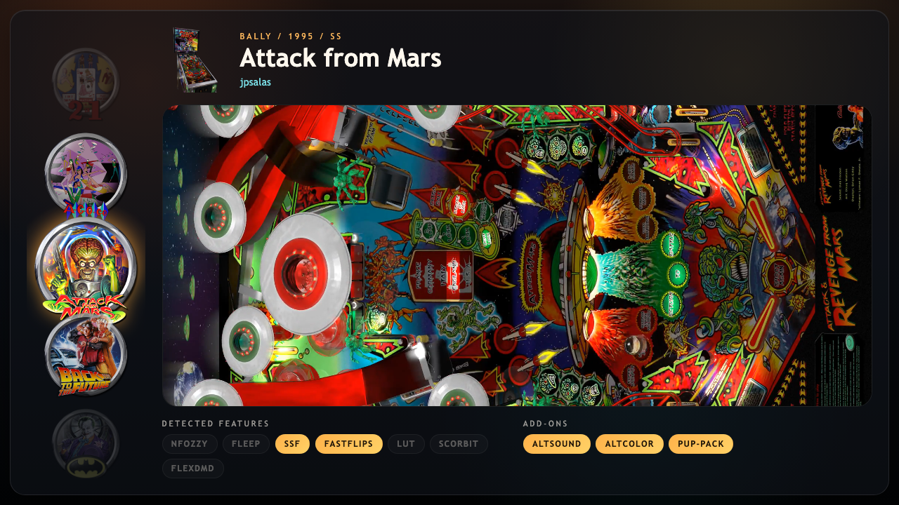
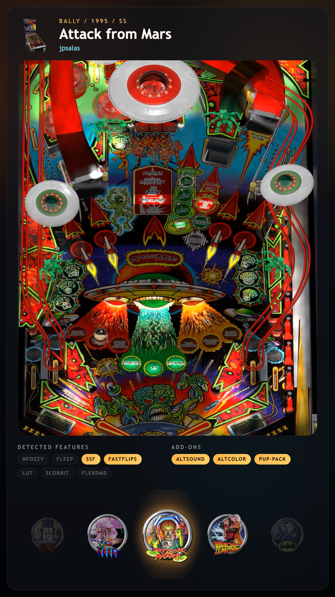

# Revolution

A theme for a desktop or a cabinet, built around a wheel.  The wheel runs down the left side.  The rest of the screen shows the table you are on: its playfield video or picture, its name, a picture of the cabinet and the features it ships with.

On a tall cabinet screen the wheel runs along the bottom instead.

The wheel slides one card at a time and cuts when you jump a page.  The playfield is the table's video or image, whichever Playfield Media Priority in VPinFE's settings asks for.

Under the name, tags show what the table has.  Features such as nFozzy, Fleep, FastFlips and Scorbit sit in one row, and add-ons such as AltSound, AltColor and PuP-Pack in another.  A tag is lit when the table has it and dim when it does not.

## Install

Open Themes in the Console, find Revolution, and press Install.  Then press Make Active and restart VPinFE.  It needs VPinFE 3.0 or later.

## Settings

These are on the Themes page in the Console, under Revolution's settings.

| Setting | What it does |
| --- | --- |
| Start on Collection Selection | Opens the collection picker as soon as the theme starts.  When it is off, Revolution starts on the collection set by Open On in VPinFE's settings.  Off by default.  If you set this in VPinFE 2.x, your choice carries over. |
